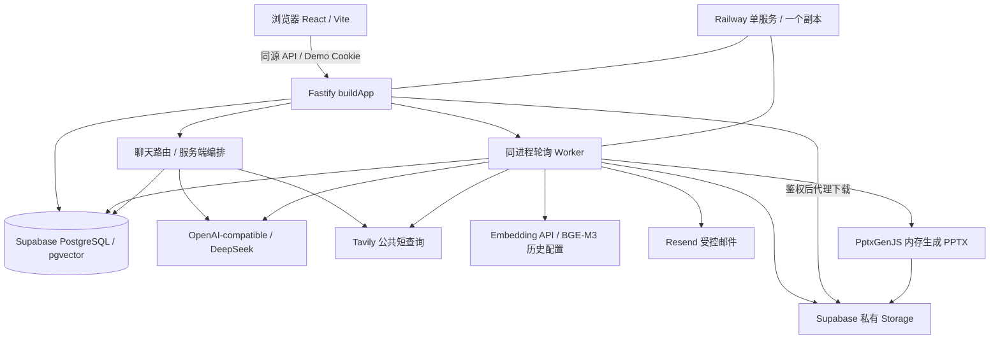

# ContextPilot 源码架构复盘

审计日期：2026-11-07。基线提交：2170fac。本报告描述仓库实现；用户确认已部署及六能力真实测试，不等于本轮重新验证线上版本。历史验收的 PASS、FAIL、NOT_RUN 应按各报告日期阅读。

## 1. 系统如何运行

ContextPilot 服务于需要反复查资料、复盘会议、跟进风险和制作汇报的工作场景。普通聊天只有当前消息上下文；这里增加持久化来源、可回查证据、跨会话记忆、受控外部动作及可恢复产物任务。六项能力可组成“聊天提出问题 → PDF/会议提供依据 → 风险与人工待办 → 确认邮件 → 记忆供新会话回查 → 搜索补充公开资料 → PPT 汇报”的闭环，但并非每次操作都依次执行六模块。

当前是保护单工作区的模块化单体。没有独立用户身份、租户、成员权限、SSO、多 Agent、Redis、工作流平台；没有 OCR、音视频转录、任意工具自主执行或生产高并发承诺。

入口 `apps/api/src/server.ts` 解析环境并启动 `app.ts:buildApp`。后者装配数据库、可取消 transport、模型与各模块，注册 API、错误处理和 Worker。开发 Vite 代理 API；生产 Fastify 托管 `dist/web`，HTML 路由回退 index。`railway.json` 构建 `npm run build`，运行编译后的 server，`/api/ready` 检查数据库，`/api/health` 只检查服务存活。ready 成功不证明模型、邮件或 Storage 可用。应用不自动迁移。

模型与 Embedding 均为配置驱动，源码没有锁死模型名。历史 Phase 5/7 记录 DeepSeek 与 SiliconFlow BAAI/bge-m3、1024 维；本轮未读取部署变量，因此不能断言线上仍使用该精确配置。`llm/adapter.ts:createChatModel` 使用非流式 chat/completions、超时、JSON object 选项和输出校验；并非供应商严格 JSON Schema。

## 2. 数据与契约

核心 Schema：`apps/api/src/db/schema.ts`；共享请求/响应 Zod 契约：`shared/*.ts`。无 `packages/`，共享代码直接位于 `shared/`。

| 实体 | 关系与不变量 |
| --- | --- |
| conversations / messages | 会话外键；会话+clientRequestId+role、会话+ordinal 唯一；消息有 processing/completed/failed 与证据快照 |
| documents / document_chunks | 文件元数据、私有对象位置、处理租约；分块保存页码、offset、文本、向量、维度、space |
| meetings / meeting_analyses | 原文及 SHA；requestedVersion/currentAnalysisId；分析按会议+版本唯一 |
| meeting_risks / risk_evidence | 潜在影响分析与逐字行号证据分开保存 |
| meeting_todos | sourceKey 去重、version 乐观锁、origin、userEdited、忽略标记 |
| email_drafts / email_draft_confirmations | 一会议一草稿；版本确认保存收件人、主题、正文、analysisId 快照 |
| email_deliveries | 永久草稿版本唯一、provider 幂等键、发送结果与核查时间 |
| memory_jobs / memories | scope、不可变来源、sourceGroup、fingerprint、来源列表及可选向量 |
| presentation_jobs | 消息唯一、请求 hash、来源/规划快照、状态、租约、文件 SHA、人工重试计数 |

迁移 0000 启用 vector；0001 聊天，0002 PDF，0003/4 会议与待办 origin，0005 记忆，0006 邮件，0007 搜索元数据，0008 PPT，0009/0010 保留式管理，0011 扩宽 PPT 页数约束。`drizzle/meta` 是生成工具状态，不能只留 SQL 删除快照。0011 的 DROP CONSTRAINT 是迁移步骤，不是删除业务数据。所有迁移仅审阅，未执行。

启用 RLS 不等于实现用户隔离：Schema 没有 owner/tenant 外键，也没有面向不同登录用户的授权策略；服务端数据库角色的实际权限还取决于部署配置。

## 3. 六个模块的真实数据流

### 3.1 多轮聊天

`chat/service.ts:createChatService.send` 先锁会话，按 clientRequestId 检查重放，检查 busy，分配 ordinal，事务创建用户与 assistant 占位消息。调用模型在事务外执行，成功/失败有条件更新占位行。相同请求 ID 的不同内容或模式返回冲突；它不是“失败后无限重试”的接口。历史接口读取最近 200 条，列表最多 100 个会话。

`chat/context.ts:buildContext` 从 completed 消息选择最近 20 条、最多 24000 字符，去掉 assistant-only 前缀；send 的候选读取最多 40 条。不是完整无限上下文或 token 级压缩。新页面通过 API 重新读取 PG 历史。过期 processing 在访问时标记 `GENERATION_INTERRUPTED`，不会重放模型调用。模型错误落 errorCode；适配器只在结构化输出或空正文的 length 情况拒绝截断，普通非空聊天 length 仍可能保留部分文本，不能宣称所有截断都拒绝。

`management.ts:setManagementFlag` 的 DELETE 会话是设置 archived_at，不是物理删除；消息、引用和文件仍保留。归档时拒绝正在生成的会话。PDF removed_at、会议 archived_at、待办 dismissed_at 同样是保留式语义。列表隐藏不等于所有按 ID 回查都不可访问，也不等于隐私擦除。

### 3.2 PDF RAG

入口 `knowledge/routes.ts` 接受原始 PDF Buffer，返回 202；`service.ts` 持久化 documents、上传私有 Storage，storageReady 后 Worker 领取。`pdf.ts:validatePdf/parsePdf/chunkPages` 检查后缀/MIME/文件头，最多 6 MiB、100 页、20 万提取字符，不支持扫描 OCR。PDF.js 逐页提取；800 字符分块，重叠 120，块不跨页，保存页码与 offset。按字符切分容易断句、表格结构可能丢失。

`embedding.ts:createEmbedder` 每批 1–16 条，检查有限数值、维度和响应 index；space 是 endpoint/model/dimensions 的 hash。数据库 variable vector 的 CHECK 约束实际维度。不是固定 vector(1024)，也未发现 HNSW/IVFFlat 索引；当前是 SQL cosineDistance 排序，不能宣称 ANN 加速。

`retrieval.ts:createRetriever` 先检查 ready 文档，再嵌入问题；按显式 documentIds、ready、removed_at、embeddingSpace、dimensions 过滤，cosine distance 取前 8，再过滤配置相似度阈值。空 ID 数组不查；没有传 IDs 时可检索可见全库，不能说任何调用都强制单 PDF。多选允许跨已选文件取证，每条引用保留 documentId，避免把 A 的页码绑定到 B。

`createKnowledgeAnswerer` 调模型返回 sourceId/quote；`verifyEvidence` 确认 ID 属于本次候选且 quote 是连续子串，文件名和页码由服务端映射。最后输出原文摘录，而不是让 LLM 自由撰写综合答案。没有候选或选中证据则明确不足。RAG 降低长文直接输入的成本/窗口压力、提供检索范围和页码；整份塞 Prompt 并不能保证注意力、定位和权限。局限是检索遗漏、分块损失、子串存在不等于语义支持、复杂跨文推理弱；不能称“消除幻觉”。测试入口 `tests/unit/knowledge.test.ts`、`tests/integration/knowledge.test.ts`、`tests/rag-live/knowledge.spec.ts`。

### 3.3 TXT 会议、风险与邮件

`meetings/analysis.ts:decodeTranscript` 仅 UTF-8 TXT，最多 1 MiB、64000 字符、4000 行。`segmentTranscript` 约 8000 字符分段、两行重叠，最多 16 段。`analyzeTranscript` 用 LLM 识别事实、潜在风险和行动，多段再合并并保留漏掉的行动。`parseAnalysis/verifyEvidence` 用 Zod、全局物理行号和连续原文核验；负责人必须在引用出现，日期必须完整显式年月日，未知为 null。风险影响是推断，不冒充已发生事实。规则辅助区分 proposal/question/decision/background，仍可能误分。

`meetings/service.ts:processOne` 在拥有租约的事务内保存分析、风险证据、待办和 memoryJob。同 sourceKey 冲突只更新分析关联与风险关联，保留人工负责人、日期、状态；风险无行动时产生标记为建议的跟进项。旧待办并非全部自动删除，需人工判断是否仍有效。`updateTodo` 用 version 与会议锁防丢更新。重分析不覆盖已有草稿；stale 与 `draft-state.ts:changedTodos/latestDraftBody` 提醒重新复核。

草稿保存、版本确认、enqueue 发送是独立动作。`email/service.ts:matchesConfirmation/enqueue` 核对当前版本、完整确认快照、当前分析及待办状态，LLM 没有发送权限。`validateRecipients` 要求全部命中服务端白名单；`reserveEmailSlot` 以全局事务 advisory lock 统计滚动一小时最多 5 个发送任务，失败/未知也计入，单任务最多 10 个地址，不等于每小时 5 封收件邮件。

draftId/version 唯一与永久 idempotencyKey 防业务重发；Worker 使用冻结 payload。Resend accepted 不等于收件箱 delivered；unknown 不自动重发，结果写库失败也不能再次 HTTP send。需要查询 provider 状态或人工核查。`email/provider.ts`、`tests/integration/email.test.ts`、`tests/unit/email-quota.test.ts` 是实现/验证入口。历史 Phase 6 有真实收件记录；Demo Kit 报告的新 opt-in 版本收件仍为 NOT_RUN，不能把历史收件套用到所有当前开关配置。

### 3.4 长期记忆

聊天用户消息在 send 事务内按 scope/messageId 入队，会议发布事务按 analysisId 入队。`memory/extraction.ts:extractChat` 调模型提取 person/time/place/topic/event/decision，逐字证据验证；`extractMeeting` 从已验证分析确定性映射，不再次让模型任意重写会议。`memory/service.ts:processOne` 读取不可变来源，保存 quote、observedAt、parent/source ID，可选嵌入。

事实身份是 scope + sourceGroup（会话或会议）+ fingerprint；同名不同来源组不按姓名合并。它没有实现全局实体解析或事实时间版本库；冲突事实保留，提示模型不能强行合并，也没有自动判定哪条最新且正确。`retrieve` 优先词法/中文二元词匹配，无匹配才向量回退（distance≤0.5），再按项目相关性与同源补全，最多 6 条/6000 字符。`answerWithMemory` 让 LLM 选已给定记忆 ID，校验后展示历史事实和出处，空选回退普通回答；并非自由综合记忆答案。

与聊天历史的区别：历史按会话顺序恢复，记忆是跨会话检索的来源化事实子集。当前会话/公开定义门禁可避免无关旧记忆污染回答。归档来源被召回过滤，但历史消息引用快照仍可能存在。测试：`tests/unit/memory.test.ts`、`tests/integration/memory.test.ts`、`tests/memory-live/`。

### 3.5 联网搜索：一次真实工程取舍

`search/service.ts:needsSearch`：off 不触发，required 必须触发，auto 用中英文时效关键词判断，并非 LLM 任意工具选择。`chat/service.ts` 当前调用 `search/public.ts:answerPublicSearch`。`createSearchProvider` 调 Tavily Basic，限制次数、超时、响应体、结果 URL，保存 title/summary/url/queriedAt/publishedAt。一次无结果可有界补搜；不能把查询时间解释成网页更新时间。

此前 `answerWithSearch → synthesis.ts/format.ts` 用 Claim/Quote JSON 和第二次模型复核。历史 v1.3.1 展示数组溢出、引文绑定、语义拒绝等问题。当前普通聊天简化成一次自然综合，去掉模型生成 URL，只展示 provider 的链接，webSources 随消息落库。优点是降低协议失败和额外调用；代价是正文不再逐 Claim 机械绑定，链接真实不能证明每句话正确。旧实现仍被 Corpus 等测试直接调用，保留作历史回放，不能拿旧协议 17 项通过证明当前搜索全部语义正确。`tests/unit/final-search-security.test.ts` 和 `v132-public.test.ts` 检查当前路径。

`publicQuery` 限制独立短问题，拒绝内部资料/上下文词、邮箱、疑似凭据等；不把历史、PDF 或记忆自动改写成搜索词。混合知识问答只允许 `explicitPublicClause` 提取用户明确写出的公共子句。PPT 有独立 webQuery。同样不能保证关键词过滤发现一切敏感信息，用户仍可能输入未被识别的私有事实；不是完整 DLP。

### 3.6 PPT

`presentations/intent.ts:isPresentationIntent/parsePresentationRequest` 用规则识别明确生成意图，提取主题、受众、语言和精确页数，默认上限 20、硬上限 30、最少 3；不是模型 function calling。聊天事务里创建 assistant 完成提示与唯一 presentationJob，马上返回排队记录。

`sources.ts:createPresentationSources` 读取显式 PDF ID（`documents.ts:selectedDocuments`，当前不是向量 top-k）、明确会议、有效人工待办版本，可选当前会话用户陈述、记忆和独立公共查询；48 来源/36000 字符超限失败。保存来源快照，不偷偷回退最近文件或整库。`plan.ts:planPresentation` 要求 LLM 只给内容页 JSON，封面/参考页服务端构造，引用/分析/建议/缺口分型；`verifyPlan` 与 `coverage.ts:verifyContentQuality` 检查完整引文、来源、必需字段正文覆盖及主题等启发式约束。

`render.ts:renderPresentation` 用 PptxGenJS 在内存生成文件，JSZip 检查结构/页数，保存计划与 SHA。Worker 先检查已有对象，不覆盖不同内容，上传后读回校验才 ready。下载 API 鉴权后代理读取，重新核 SHA/大小/结构，不公开 Bucket、不把永久公开 URL 发给浏览器。历史按 PG 任务恢复，非本机目录扫描。

规划原输出与失败记录可保留；结构化截断直接失败。普通失败仅人工显式重试一次；replan 留 planningHistory，已有对象禁止重新规划覆盖。发布前 `assertCurrentPresentationTodos` 再读并加共享锁核对版本，人工编辑后拒绝发布旧待办。ready 历史文件代表原快照，不自动随待办更新。任务异步化是因为来源收集、模型、渲染、上传/读回跨多个慢操作；长 HTTP 占用与断线无法可靠表示进度。任务持久化支持刷新/重启追踪，不等于每次外部调用都 exactly-once。相关测试 `tests/unit/ppt-v13.test.ts`、`v131-regressions.test.ts`、`v132.test.ts`、`tests/integration/presentations.test.ts`。

## 4. Worker 与可靠性

`knowledge/service.ts:startDocumentWorker` 是复用轮询循环，路由 onReady 启动，preClose 停止，和 API 在同一个进程，不是 Railway 独立 Worker 服务。PDF/会议用对应表充当任务，记忆/PPT/邮件有独立 job 表。

PDF/会议/记忆/PPT 通过短事务 `FOR UPDATE SKIP LOCKED` 领取，随机 leaseToken、5 分钟租约、约 30 秒心跳；写回带 token 条件，避免过期旧 worker 发布。过期处理中任务在 attempts<2 时可接管，两次中断后记录失败；业务异常通常直接 failed，并非无限自动重试。邮件策略不同：可能发出的过期 processing 转 unknown，不能盲目接管重发。状态、尝试次数、errorCode 与产物信息都在 PG，不依赖进程内队列恢复。

幂等分层：聊天 clientRequestId；记忆来源唯一；会议内容 SHA/分析版本；PPT assistantMessageId 与请求 hash/对象 SHA；邮件 draft/version 与 provider key。PG 支持并发领取，不能因共享数据库就说不支持并发。历史 `tests/integration/memory.test.ts`、`worker-isolation.test.ts` 验证双连接池竞争、过期接管、旧 token 发布隔离；PPT Corpus M04 验证编辑竞态。它们不是高并发压测。

剩余窗口：DB 与外部 API/Storage 不在同一事务；租约失效不能撤销已经开始的模型请求；心跳错误被吞并等待后续条件写回，不是分布式取消；源快照和资源归档间并非所有场景都有统一发布锁；相同配置的本地与线上实例会消费同队列。进程内搜索/AI 限额重启后重置，也不是账户级预算硬锁。未来应先补故障注入、指标和并发边界验证，再决定扩 Worker，不必先引入 Redis。

## 5. 安全边界

`demo/access.ts` 的 Demo Key 换取 8 小时 HMAC Cookie，HttpOnly/SameSite=Strict，生产 Secure；轮换密钥使旧签名失效。API hook、写请求 Origin 检查、进程级速率限制保护入口，但口令持有人共享资源和配额，没有独立用户/行所有权。历史 Cookie 风险见 `mvp-final-closeout.md`；生产密钥是否已轮换本轮未知，不读取凭据验证。`presentations/auth.ts` 保留 PPT 兼容鉴权，全站 Demo 登录优先。

PDF/TXT/网页是 untrusted data；提示限制、Zod、逐字证据、选定来源与权限分离是多层防护。模型不能因为文档里的“授权”发送邮件，也不能传任意文件路径或 URL 下载。`SafeMarkdown.tsx` 的安全渲染与测试是前端另一层。提示与正则不能证明绝对免疫 Prompt Injection。所有登录访客能访问同工作区资料，应仅放合成数据；归档不是擦除，未知事实与外部内容仍需人工核对。

产品化顺序：独立身份 → workspace/member/owner 外键 → 每条查询与下载的所有权检查 → 数据库 RLS 策略及服务角色审查 → 租户级 job/Storage 路径与预算 → 迁移/越权测试和审计记录。单工作区减少 MVP 权限面，不能将 scope/config hash 直接包装成多租户授权。

## 6. 技术选型（以下为基于实现的工程解释）

除有历史修复证据的条目外，不推断开发者当时动机。每行依次给出选择、问题、收益、代价、替代及本项目取舍。

| 选择 | 解决问题与优点 | 代价 | 替代及本项目取舍 |
| --- | --- | --- | --- |
| TypeScript + Zod | 前后端共享类型，外部输出运行时校验 | 类型无法证明模型语义正确 | JS/JSON Schema；此项目两端 TS 与 shared 契约已有一致链路 |
| React/Vite | 状态面板、轮询、开发代理、静态构建 | 需管理异步竞态和 UI 状态 | Next.js/服务端模板；现有静态前端配 Fastify 足够，无需 SSR |
| Fastify | 插件生命周期、路由、统一错误与服务装配 | 自己管理工作流与授权 | Express/Nest；模块化单体无需额外框架层 |
| PostgreSQL/Drizzle | 事务、外键、唯一约束、持久化任务一起落库 | 数据库同时承担业务与调度负载 | SQLite/文档库；当前强一致业务约束更适合 PG |
| pgvector | 向量与来源关系在同一数据库过滤 | 当前精确排序规模受限，无 ANN 声明 | 专用向量库；MVP 少一个独立系统，扩容须实测 |
| DeepSeek/OpenAI-compatible 与 BGE-M3 | 文本推理和向量通过独立适配器复用 | 服务时效、截断、限额及嵌入空间迁移 | 其他模型/本地模型；历史真实验收证明曾可用，不宣称最优或最新价格 |
| Supabase 私有 Storage | 重启后文件保留、对象与业务行分离 | DB/对象跨系统一致性需补偿 | 本地盘/S3；Railway 临时运行文件不承担业务持久化 |
| PG 租约队列 | 任务和业务事务入队，减少部署组件 | 调度/监控/重试靠自研、轮询负载 | BullMQ/Redis；当前任务类型有限，已有锁和状态机，不为框架增加运维面 |
| Railway 单服务 | 同源前后端与 Worker 简化演示运行 | 单副本共享故障域、环境与启动易出错 | VM/容器平台；现有部署配置适配单体，不声称高可用 |

## 7. 代表性修复：已修复与仍有限制

| 案例 | 现象 → 根因 → 定位 | 修复 → 验证 → 教训 |
| --- | --- | --- |
| 严格 TLS | TCP 可达、业务 500，SELF_SIGNED_CERT_IN_CHAIN；容器诊断指向 CA 信任链 | 903382e 将公开 CA 构建到服务端，保持 rejectUnauthorized；database-config 测试及 `db:tls` 只读诊断。历史 phase-9 后续记录用户确认公网 TLS 可用，本轮不复验。连通不是 TLS 信任通过 |
| RAG 引用 | 模型可能伪造来源/页码；检查 retrieval 选择输出而不是相信正文 | 服务端由块 ID 绑定页码与原文子串，伪 ID/引文测试拒绝。代价是摘录式回答；仍需未来证据支持的综合评估，上传偶发 500 仍 OPEN |
| 搜索过度审核 | v1.3.1 格式超量、引文错绑和语义复核失败；脱敏快照回放定位 | 76329f0/39f1a80 路由切到自然综合，当前路径测试与 final-closeout 有界真实调用记录。部分时效结论仍不足，不能把 200 或少报错当准确率提升证明 |
| PPT 误判为聊天 | 带“不要输出制作指导”的请求出现 LLM_OUTPUT_TRUNCATED 且无 job | 3c623df 修意图否定范围；v132 固定回归与 v1.3.2 有界真实 PPT。先查路由再查 token，不全局加额度掩盖错误 |
| PPT 关键事实遗漏 | 文件结构有效但提议/owner/date 不在正文；检查 sources、plan、PPT 文本逐层定位 | v1.3.1 补 proposal/coverage slots/人工待办表格及发布前版本核对；固定回放、PG M04 和后续真实 A/B 记录。类型覆盖不代表事实覆盖，旧文件不自动改写 |
| 邮件重复风险 | 超时或发出后写库失败会让客户端以为没发；跨系统结果不确定 | 永久业务去重、精确版本快照、unknown 不自动重发、配额锁；email 单元/DB 测试与 Phase6 历史收件。代价是 unknown 要人工核查，不承诺 exactly-once 投递 |
| 共享 Worker 抢任务 | Phase5 未插桩开发实例领取真实验收会议；端口不同仍共享 PG | scope/storage/space 领取条件与隔离测试、受控验收进程；同配置实例仍共享队列，默认端口探测不是全局排他锁 |
| 启动失败反复重启 | 最新 2170fac 增加环境/应用/插件/listen 阶段诊断；用户所述具体 Railway 缺失变量本轮未读云端确认 | startupDiagnostic 只输出允许字段，CA 不可读定位字段；startup-diagnostic 测试和 production smoke。根因须根据脱敏部署日志判断，不能把通用诊断补丁写成已证实某个缺失 startCommand；railway.json 当前已有 startCommand |

历史原文入口：`phase-5-verification.md`、`phase-9-verification.md`、`mvp-v1.3.1-verification.md`、`mvp-v1.3.2-verification.md`、`mvp-final-closeout.md`、`demo-kit-verification.md`。本轮验证清单见 [仓库审计](REPOSITORY_AUDIT.md)。

## 8. 本地接入与前端回归补充

此节保留已删除早期 setup/UI 报告中仍适用的独有操作边界；旧版本全文可从清理前提交 ac43dac 读取，不把早期计数或未实现状态当成当前说明。

- 配置只在仓库根目录本地 .env 填写，参考 .env.example；不要覆盖已有配置，不使用 VITE_* 存储后端密钥。数据库 URI 从供应商 Connect 面板取得，Direct/Session pooler 用户名不同；密码仅编码一次，URL 不带 query/hash，保持真实 DNS 主机和严格证书验证。
- 历史 Phase2 本机到 pooler 的 TLS encrypted/authorized 已验证，但 pg_stat_ssl 当时显示 pooler→数据库未启用 SSL；这两个连接段不能混为一谈。当前云端 SSL enforcement 未在本轮核实，修改可能重启数据库，应由维护者另行检查，不能靠关闭客户端校验解决。
- LLM_BASE_URL 和 EMBEDDING_BASE_URL 是 API 前缀，服务端分别追加 /chat/completions、/embeddings。Embedding 输出必须与配置维度一致，不自动请求降维。Storage 使用已有私有 Bucket 和后端权限，文件大小/MIME 限制需匹配 PDF、TXT、PPTX；没有前端匿名公开上传策略。
- 手动审查迁移后再执行 db:migrate；db:check/db:tls/db:status 需有真实数据库授权，启动不自动迁移。integration 使用真实 PG 与标注外部替身；live 会创建持久记录并可能计费，运行前需要预算/数据授权。不要同端口并行测试，或让本地与 Railway 同配置 Worker 同时消费验收队列。
- PDF 合成夹具说明见 tests/fixtures 与 demo/files/SHA256.json；重生成入口 scripts/generate-rag-fixtures.py 需要 ReportLab，正常构建和演示不需要 Python。没有保险合同号的夹具问题应返回证据不足。
- 前端具体交互契约保留在 SPEC.md；PDF 多选/45项列表/嵌套 Escape/请求 ID 范围、IME 防误发/失败保留/上传中切会话等有 tests/e2e/ui-final.spec.ts 与 workspace.spec.ts 的实际回归。UI fixtures 不证明真实模型结果；实体手机软键盘、系统 IME 与跨浏览器专项仍需人工，当前后续项见 TASKS.md。
